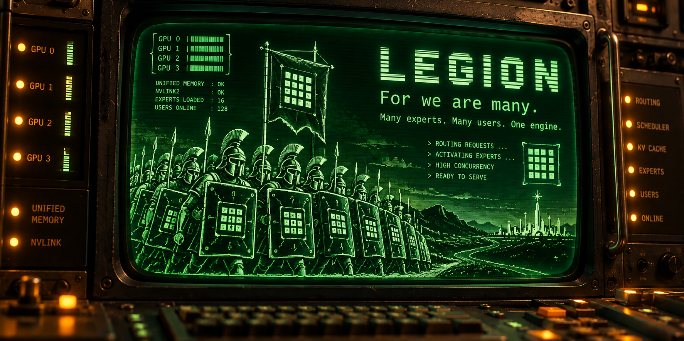

# Legion

<p align="center">
  
</p>

<p align="center">
  <a href="https://github.com/eelgaev/Legion/actions/workflows/ci.yml"></a>
  <a href="LICENSE"></a>
  <a href="rust-toolchain.toml"></a>
</p>

Legion is an LLM inference engine for mixture-of-experts models on NVIDIA unified-memory systems.
It is Rust first: the host side is Rust, kernels are PTX where we can, and C/C++ only where there
is no other choice (ggml provides the quantized kernels underneath).

- **Models.** First-class: [Qwen3.8-Flash-Next](https://huggingface.co/Qwen/Qwen3.8-Flash-Next) (Qwen4 architecture),
  [GLM5.3-Flash](https://huggingface.co/zai-org/GLM-5.3-Flash) and [DeepSeek4.1-Flash](https://huggingface.co/deepseek-ai/DeepSeek-V4.1-Flash).
  Also supported: [Gemma 4](https://huggingface.co/google/gemma-4-31B-it), [Qwen3.8-27B](https://huggingface.co/Qwen/Qwen3.8-27B) and smaller
  MoEs such as [Nemotron3.5-30B-A3B](https://huggingface.co/nvidia/NVIDIA-Nemotron-3.5-Lightning-30B-A3B-BF16),
  [Qwen3.6-35B-A3B](https://huggingface.co/Qwen/Qwen3.6-35B-A3B) and [Gemma4-26B-A4B](https://huggingface.co/google/gemma-4-26B-A4B-it).
- **Hardware.** Built for unified memory: very good support for the IBM AC922 (V100
  over NVLink 2.0 + ATS) and the DGX Spark (GB10). Models bigger than VRAM keep their
  experts in host memory, read in place or cached in VRAM by heat. Minimum GPU: sm_70 (Volta).
- **Formats.** GGUF, and Hugging Face safetensors as shipped (BF16, FP8, NVFP4 and more), with no
  conversion step. See [GGUF and safetensors, one engine](#gguf-and-safetensors-one-engine).
- **One user or many.** Fast single-stream decode with speculative decoding (MTP, n-gram, draft
  models, EAGLE-3, DFlash), and continuous batching with paged KV. The aim is to beat vLLM and
  SGLang on concurrency and on usability.
- **Prefix caching for hybrid models too.** A radix tree of cached prompt prefixes (the approach
  SGLang popularized as RadixAttention), on by default. For hybrid models (Gated DeltaNet, Mamba)
  Legion also saves their recurrent states, including one past each reply, so a multi-turn chat or
  an agent loop computes only its new tokens: a repeated 5.8K-token prompt starts in 0.07 s instead
  of 3.6 s on a DGX Spark.
- **Images.** Qwen3.5 / 3.6 models take images through `--mmproj` (all three APIs and the web UI).
- **Fast prefill.** Fused expert kernels, sparse attention and pipelined prompt chunks over several
  GPUs.
- **Easy to use.** One binary: point `legion serve` at a GGUF file or a checkpoint directory.

## GGUF and safetensors, one engine

Most engines pick a side: llama.cpp-style engines run GGUF, vLLM- and SGLang-style engines run
Hugging Face checkpoints. Legion runs both, with the same scheduler, KV cache, speculative decoding
and kernels underneath. `legion serve --model` takes a GGUF file or a checkpoint directory and
figures out the rest.

- **The release as shipped.** NVFP4 (NVIDIA ModelOpt and compressed-tensors), FP8 and BF16
  safetensors load as they are: no conversion to GGUF and no dequantization to BF16. A vendor's
  official quantized release runs the day it is published, at the precision it was published in.
- **The community quants too.** unsloth's dynamic GGUFs, QAT GGUFs and smaller custom quants
  (like Maya-S for GLM5.3-Flash) for boxes where the safetensors release does not fit.
- **Mix them.** A safetensors target with a separately released drafter, or a GGUF target with
  its MTP head from another file: Qwen3.8-27B NVFP4 drafts with z-lab's BF16 DFlash 2 model.
- **Compare like with like.** One engine and one benchmark for both formats, so a GGUF and an NVFP4
  row of the same model differ only by the weights.

| Model | GGUF | Safetensors |
|---|---|---|
| Qwen3.8-Flash-Next | unsloth UD-Q4_K_XL and others | NVIDIA NVFP4 (with its own MTP head) |
| Qwen3.8-27B | yes | unsloth and RadixArk NVFP4 |
| GLM5.3-Flash | unsloth UD-Q4_K_XL, Maya-S | NVIDIA NVFP4 |
| Gemma 4 31B | QAT Q4_0 / UD-Q4_K_XL, with MTP | NVIDIA and RedHatAI NVFP4 |
| Qwen3.5 / 3.6, Nemotron-H | yes | BF16, FP8, NVFP4 |
| DeepSeek4.1-Flash | yes | FP8 / MXFP4 (being tuned) |

**Status:** Qwen3.5 / 3.6 (dense and MoE), Qwen3.8-Flash-Next, Qwen3.8-27B, Gemma 4, GLM5.3-Flash and
Nemotron-H serve on CUDA, on one or several GPUs, from GGUF or safetensors. DeepSeek4.1-Flash is
being tuned.

## Performance

Legion next to llama.cpp (GGUF weights) and vLLM (safetensors), on the same machines, weights, drafters and
benchmark client. One table per model, one row per machine and engine. **Decode** is in tokens per second at 1, 4
and 16 users: per request at 1 user, the total over all requests at 4 and 16. **Prefill** is one prompt of 8K,
32K or 123K tokens, in tokens per second. With drafting (MTP, DFlash 2) the 1-user speed
depends on the prompt: a range such as 23-51 is the slowest to the fastest of the fixed benchmark prompts (prose,
code, lists, chats), from the 2026-11-03 runs. `—`: not measured or did not finish (see the notes). **Bold**: Legion beats the other engine on the same machine with the same kind of weights (llama.cpp or Project Maya for GGUF,
vLLM for NVFP4; at 1 user by median). Legion's greedy output is identical to the run without the opt-in flags unless a note
says otherwise. Every command, Legion's and the other engines', is
in [Run commands](#run-commands).

Engines: Legion `main`; llama.cpp b12062 (`29c720e`, 2026-11-02, stock build); vLLM 0.33.0 (DGX Spark only; vLLM does not
support the V100); [Project Maya](https://github.com/mw00/project-maya) v1.1.51, the engine the Maya-S GGUFs are made
for (AC922, Maya-S only, its recommended setup: one sequence, its own MTP drafting). All with 16 sequences (`--max-seqs 16`, `-np 16 -kvu`, `--max-num-seqs 16`) and prefix caching
off. llama.cpp runs across two DGX Sparks with its RPC backend (layer split).

### Qwen3.8-Flash-Next

| Machine | Engine | Weights | Drafting | Decode, 1 user | 4 users | 16 users | Prefill 8K | 32K | 123K |
|---|---|---|---|--:|--:|--:|--:|--:|--:|
| DGX Spark | Legion | [UD-Q4_K_XL GGUF](https://huggingface.co/unsloth/Qwen3.8-Flash-Next-GGUF) | MTP | **44-64** | **83.8** | **109.4** | **1,872** | **2,008** | 1,916 |
| DGX Spark | llama.cpp b12062 | UD-Q4_K_XL GGUF | none ¹ | 27-28 | 55.5 | 90.0 | 955 | 891 | — |
| DGX Spark | Legion | [NVFP4](https://huggingface.co/nvidia/Qwen3.8-Flash-Next-NVFP4) | MTP ² | **36-59** | **91.7** | **172.9** | **2,353** | **2,450** | **2,276** |
| DGX Spark | vLLM 0.33.0 | NVFP4 | MTP ³ | 28-39 | 72.9 | 150.3 | 1,797 | 2,381 | 1,663 |
| 2x DGX Spark | Legion | UD-Q4_K_XL GGUF | MTP ⁴ | **55-70** | **112.6** | **216.9** | **2,933** | **2,940** | **2,758** |
| 2x DGX Spark | llama.cpp b12062 | UD-Q4_K_XL GGUF | none ⁵ | 23-26 | 47.4 | 75.0 | 1,066 | 1,064 | 1,014 |
| 2x DGX Spark | Legion | NVFP4 | MTP ⁴ | 39-52 | 113.7 | 240.5 | **3,469** | **3,380** | 3,127 |
| 2x DGX Spark | vLLM 0.33.0 | NVFP4 | MTP ⁶ | 43-58 | 116.8 | 248.5 | 3,174 | 3,257 | 3,135 |
| AC922, 2x V100 | Legion | UD-Q4_K_XL GGUF | MTP ⁷ | **70-90** | **86.4** | 88.5 | **2,789** | 4,094 | 4,302 |
| AC922, 2x V100 | llama.cpp b12062 | UD-Q4_K_XL GGUF | MTP ⁸ | 11-13 | 7.3 | — | 120 | — | — |
| AC922, 4x V100 | Legion | UD-Q4_K_XL GGUF | MTP ⁷ | **79-101** | 118.6 | 136.2 | 4,370 | 6,316 | 8,050 |
| AC922, 4x V100 | llama.cpp b12062 | UD-Q4_K_XL GGUF | MTP ⁸ | 6-9 | — | — | — | — | — |

### Qwen3.8-27B

| Machine | Engine | Weights | Drafting | Decode, 1 user | 4 users | 16 users | Prefill 8K | 32K | 123K |
|---|---|---|---|--:|--:|--:|--:|--:|--:|
| DGX Spark | Legion | [UD-Q4_K_XL GGUF](https://huggingface.co/unsloth/Qwen3.8-27B-GGUF) | MTP ⁹ | **23-40** | **80.1** | **121.7** | **880** | **822** | 652 |
| DGX Spark | llama.cpp b12062 | UD-Q4_K_XL GGUF | MTP n=3 | 22-31 | 61.4 | 108.3 | 821 | 795 | — |
| DGX Spark | Legion | [NVFP4](https://huggingface.co/unsloth/Qwen3.8-27B-NVFP4) | DFlash 2 ⁹ | **23-51** | **97.0** | **235.2** | **2,697** | **2,309** | 1,438 |
| DGX Spark | vLLM 0.33.0 | NVFP4 | DFlash 2 | 20-45 | 84.2 | 193.1 | 2,548 | 2,140 | — |
| AC922, 2x V100 | Legion | UD-Q4_K_XL GGUF | MTP ⁹ | 58-79 | **122.1** | **194.6** | **1,375** | **1,023** | **509** |
| AC922, 2x V100 | llama.cpp b12062 | UD-Q4_K_XL GGUF | MTP n=3 | 63-85 | 105.4 | 148.6 | 807 | 732 | 500 |

### Gemma 4 31B

| Machine | Engine | Weights | Drafting | Decode, 1 user | 4 users | 16 users | Prefill 8K | 32K | 123K |
|---|---|---|---|--:|--:|--:|--:|--:|--:|
| DGX Spark | Legion | [QAT UD-Q4_K_XL GGUF](https://huggingface.co/unsloth/gemma-4-31B-it-qat-GGUF) | MTP ⁹ | **24-49** | **93.0** | **254.9** | **791** | **704** | 532 |
| DGX Spark | llama.cpp b12062 | QAT UD-Q4_K_XL GGUF | MTP n=3 | 24-36 | 65.1 | 213.9 | 773 | 671 | — |
| DGX Spark | Legion | [NVFP4](https://huggingface.co/RedHatAI/gemma-4-31B-it-NVFP4) | DFlash 2 ¹⁰ | **22-39** | **83.9** | **252.4** | **2,041** | **1,630** | 907 |
| DGX Spark | vLLM 0.33.0 | NVFP4 | DFlash 2 | 18-35 | 77.5 | 244.3 | 1,795 | 1,029 | — |
| 2x DGX Spark | Legion | QAT UD-Q4_K_XL GGUF | MTP ¹¹ | 37-66 | 119.9 | 202.6 | 975 | 925 | 744 |
| AC922, 2x V100 | Legion | QAT UD-Q4_K_XL GGUF | MTP ¹² | 64-106 | **141.1** | **247.2** | **1,000** | **799** | **441** |
| AC922, 2x V100 | llama.cpp b12062 | QAT UD-Q4_K_XL GGUF | MTP n=3 | 75-102 | 129.1 | 196.4 | 774 | 489 | 288 |

### GLM-5.3-Flash Maya-S v2 IQ2_XXS

| Machine | Engine | Weights | Drafting | Decode, 1 user | 4 users | 16 users | Prefill 8K | 32K | 123K |
|---|---|---|---|--:|--:|--:|--:|--:|--:|
| DGX Spark | Legion | [GGUF](https://huggingface.co/peasantsmith/GLM-5.3-Flash-Maya-GGUF) | MTP k=2 ⁹ | 24-29 | **42.5** | **69.3** | **689** | **633** | **498** |
| DGX Spark | llama.cpp b12062 | GGUF | MTP n=2 | 25-27 | 39.4 | 58.6 | 331 | 313 | — ¹⁶ |
| AC922, 4x V100 | Legion | GGUF | MTP k=2 ¹³ | **61-68** | **71.4** | **84.0** | **1,299** | **1,302** | **1,205** |
| AC922, 4x V100 | Project Maya 1.1.51 | GGUF | MTP ¹⁴ | 53-63 | 52.2 | — | 859 | 1,214 | — |

### GLM-5.3-Flash UD-Q4_K_XL

| Machine | Engine | Weights | Drafting | Decode, 1 user | 4 users | 16 users | Prefill 8K | 32K | 123K |
|---|---|---|---|--:|--:|--:|--:|--:|--:|
| AC922, 4x V100 | Legion | [UD-Q4_K_XL GGUF](https://huggingface.co/unsloth/GLM-5.3-Flash-GGUF) | MTP k=2 ¹³ | **39-44** | **42.7** | 55.4 | **1,198** | **1,171** | 1,120 |
| AC922, 4x V100 | llama.cpp b12062 | UD-Q4_K_XL GGUF | MTP n=2 ¹⁵ | 3-4 | 3.4 | — | 25 | — | — |

¹ No drafting: llama.cpp b12062 aborts with the MTP drafter on this model. 123K did not finish in 20 minutes.

² The checkpoint's own MTP head, with the output-moving opt-ins `--spec-gate-cost-model off`, `--nvfp4-expert-rows-bf16` and `--hc-bf16` (see the run command; decode and prefill from one 2026-11-12 run; prefill without the last two: 2,146, 2,205, 2,071).

³ A local patch maps the FP8 n-gram table from disk; stock vLLM does not fit it in memory (see the run command).

⁴ Tensor parallel over one QSFP link.

⁵ RPC backend (layer split). No drafting, as in ¹.

⁶ Tensor parallel over one QSFP link, with CUDA graphs (see the run command).

⁷ Opt-in speed flags, see the run command.

⁸ The weights do not fit the GPUs, so part runs from host memory. Empty cells did not finish in 20 minutes.

⁹ Output-moving opt-in flags, see the run command.

¹⁰ Output-moving opt-in flags, see the run command (without them: 18-33, 70.2, 154.3, 897, 710, 587).

¹¹ Tensor parallel over one QSFP link.

¹² 16 sequences of 262,144 tokens each (llama.cpp: 262,144 in all); the cache is in host memory. Output-moving opt-in flags at 8 or more users, see the run command.

¹³ 16 sequences, 131072 context. Output-moving opt-in flags past 8 users (`--glm-decode-mv`, `--spec-gate-cost-model off`), see the run command.

¹⁴ One sequence (`--parallel 1`, Maya's default): 4 users are answered one at a time. Its `--parallel 4` fails on 16 GB V100s.

¹⁵ The weights do not fit the GPUs and run from unified memory; `-sm tensor` does not support GLM, so the layers are split. 32K prefill did not finish in 20 minutes; 16 users and 123K were not run.

¹⁶ The 123K request (about 86K GLM tokens) does not fit the run command's 64K context (`-c 65536`, shared by 16 sequences).

Measured 2026-10-20 to 2026-11-12. Each new speed record is added here.

## Roadmap

**Models.**

- **DeepSeek4.1-Flash.** Tuned decode and prefill on the AC922 and the DGX Spark (today it serves
  from GGUF but is not tuned yet), its FP8/MXFP4 safetensors as shipped, and a two-Spark setup.

**Hardware**, after the AC922 and the DGX Spark, in this order:

1. **Gaming PCs with MoE streaming.** RTX 30/40/50 cards with 16-32 GB of VRAM on PCIe. MoE models
   much larger than VRAM: the hot experts stay cached in VRAM, the rest are read from host RAM or
   straight from an NVMe SSD, and the next layers' experts are prefetched while the current
   layer runs.
2. **Grace Hopper (GH200).** H100/H200 behind NVLink-C2C to the Grace CPU, unified memory like the
   AC922 and the Spark but much faster, so host-resident experts cost far less.
3. **Grace Blackwell (GB200 / GB300).** Blackwell GPUs with Grace over NVLink-C2C, native NVFP4
   tensor cores, and several GPUs in one NVLink domain for tensor and expert parallelism.

## Run commands

The exact `legion serve` command behind every row of the tables, and how it was measured ([docs/run](docs/run/README.md)):

**llama.cpp, vLLM and Project Maya:** [the commands behind their rows](docs/run/other-engines.md), model by model, next to Legion's.

**DGX Spark**

- [Qwen3.8-Flash-Next UD-Q4_K_XL, 2x Spark (tensor parallel)](docs/run/spark/qwen38-flash-next-ud-q4-k-xl-2x-tp.md)
- [Qwen3.8-Flash-Next UD-Q4_K_XL, 1x Spark](docs/run/spark/qwen38-flash-next-ud-q4-k-xl-1x.md)
- [Qwen3.8-Flash-Next NVFP4, 1x Spark](docs/run/spark/qwen38-flash-next-nvfp4-1x.md)
- [Qwen3.8-Flash-Next NVFP4, 2x Spark (tensor parallel)](docs/run/spark/qwen38-flash-next-nvfp4-2x-tp.md)
- [GLM-5.3-Flash Maya-S v2 (IQ2_XXS), 1x Spark](docs/run/spark/glm-53-flash-maya-s-v2-iq2-xxs-1x.md)
- [Qwen3.8-27B UD-Q4_K_XL, 1x Spark](docs/run/spark/qwen38-27b-ud-q4-k-xl-1x.md)
- [Qwen3.8-27B NVFP4, 1x Spark](docs/run/spark/qwen38-27b-nvfp4-1x.md)
- [Gemma 4 31B QAT UD-Q4_K_XL, 2x Spark (tensor parallel)](docs/run/spark/gemma-4-31b-qat-ud-q4-k-xl-2x-tp.md)
- [Gemma 4 31B QAT UD-Q4_K_XL, 1x Spark](docs/run/spark/gemma-4-31b-qat-ud-q4-k-xl-1x.md)
- [Gemma 4 31B NVFP4 (RedHatAI), 1x Spark](docs/run/spark/gemma-4-31b-nvfp4-1x.md)

**IBM AC922**

- [Qwen3.8-Flash-Next UD-Q4_K_XL, 4x V100 SXM2 16 GB](docs/run/ac922/qwen38-flash-next-ud-q4-k-xl-4x.md)
- [Qwen3.8-Flash-Next UD-Q4_K_XL, 2x V100 SXM2 16 GB](docs/run/ac922/qwen38-flash-next-ud-q4-k-xl-2x.md)
- [GLM-5.3-Flash Maya-S v2 (IQ2_XXS), 4x V100 SXM2 16 GB](docs/run/ac922/glm-53-flash-maya-s-v2-iq2-xxs-4x.md)
- [GLM-5.3-Flash UD-Q4_K_XL, 4x V100 SXM2 16 GB](docs/run/ac922/glm-53-flash-ud-q4-k-xl-4x.md)
- [Gemma 4 31B QAT UD-Q4_K_XL, 2x V100 SXM2 16 GB](docs/run/ac922/gemma-4-31b-qat-ud-q4-k-xl-2x.md)
- [Qwen3.8-27B UD-Q4_K_XL, 2x V100 SXM2 16 GB](docs/run/ac922/qwen38-27b-ud-q4-k-xl-2x.md)

## Build

```sh
git submodule update --init third_party/ggml
cargo build --release                          # CPU ggml
CMAKE_CUDA_ARCHITECTURES=121 cargo build --release --features cuda  # GB10; 120 = RTX 50, 70 = V100
```

Requirements: Rust (the version pinned in `rust-toolchain.toml`), cmake, a C/C++ compiler, and libclang (for bindgen); CUDA builds require nvcc. V100 (sm_70) builds need CUDA 12.x (12.2+): CUDA 13 dropped sm_70.

## Run

```sh
legion serve --port 8090                       # mock engine (no model)
legion serve --model <model.gguf|hf-dir> --device cuda --gpus 2 --port 8090   # layers split over 2 GPUs
legion serve --model <model.gguf|hf-dir> --device cuda --tp 2 --port 8090     # tensor parallel over 2 GPUs (dense models)
legion gguf inspect model.gguf
legion bench --url http://localhost:8090 --concurrency 1,8,32 # benchmark a server
legion st inspect <file|dir>                  # inspect safetensors files/checkpoints
legion completions bash > ~/.local/share/bash-completion/completions/legion
legion completions fish > ~/.config/fish/completions/legion.fish
```

**Web UI:** accessible at [http://localhost:8090/](http://localhost:8090/) after `legion serve`.
Features:
- conversation sidebar with search, rename and delete (stored in the browser's IndexedDB)
- markdown with highlighted code blocks and a copy button
- collapsible thinking block and per-reply stats (tokens, time to first token, tokens/s)
- settings dialog (system prompt, sampling parameters, custom JSON, model, theme, API key)
- stop, edit, regenerate, copy and delete for messages
Use `--no-webui` to turn it off.
Conversations are stored only in the browser (IndexedDB).

**Auth:** `legion serve --api-key KEY` (or `LEGION_API_KEY`); clients send `Authorization: Bearer KEY` or `x-api-key: KEY`.

**HTTPS:** provide both a PEM certificate chain and a PKCS#8 or RSA private key. For example:

```sh
legion serve --api-key KEY --tls-cert cert.pem --tls-key key.pem
```

The equivalent environment variables are `LEGION_TLS_CERT` and `LEGION_TLS_KEY`.

## Docs

- [docs/run](docs/run/README.md): the command lines behind the performance tables, one page per model and machine (DGX Spark, IBM AC922)
- [docs/ac922.md](docs/ac922.md): running on the IBM AC922: RHEL 8, NVLink 2.0, the kernel and driver it needs (550.54.15, the power9-nvidia-nvlink2 patches), gcc-toolset-12, build and run
- [docs/serving.md](docs/serving.md): guide to running the server and connecting clients
- [docs/clients.md](docs/clients.md): curl, open-webui, openai-python, anthropic-python and Claude Code against `legion serve`
- [docs/tuning-integrated-gpus.md](docs/tuning-integrated-gpus.md): speculative-decoding settings for the DGX Spark (GB10), with measurements and recommended command lines
- [docs/tuning-multi-gpu-prefill.md](docs/tuning-multi-gpu-prefill.md): long prompts over several discrete GPUs: where a pipeline round's time goes, the layer split and chunk-size settings, with measurements
- [docs/api.md](docs/api.md): HTTP API request fields and response examples
- [docs/architecture.md](docs/architecture.md): module map, request flow, where the engine plugs in
- [CONTRIBUTING.md](CONTRIBUTING.md): how to contribute: the checks a PR must pass, the code rules (Rust only, byte-identical defaults), AI-assisted work
